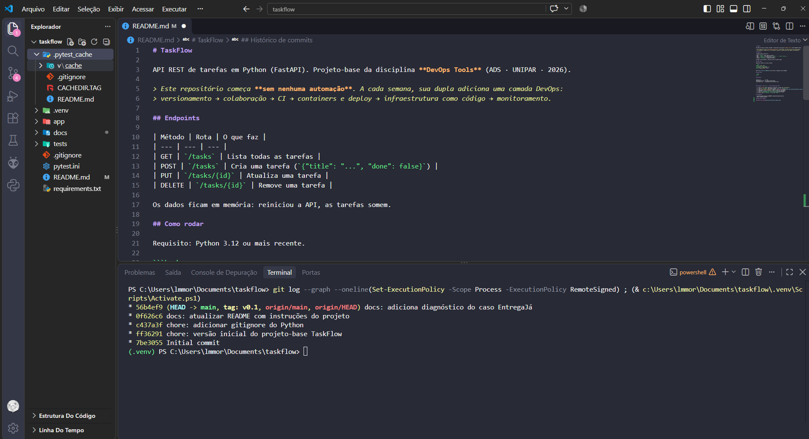
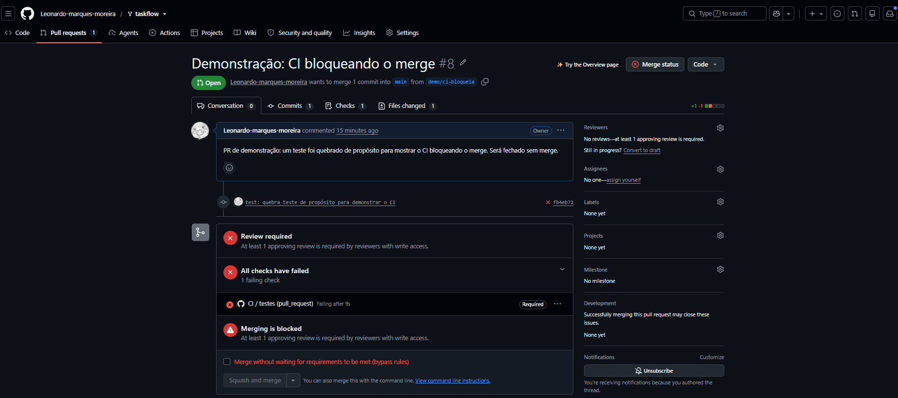
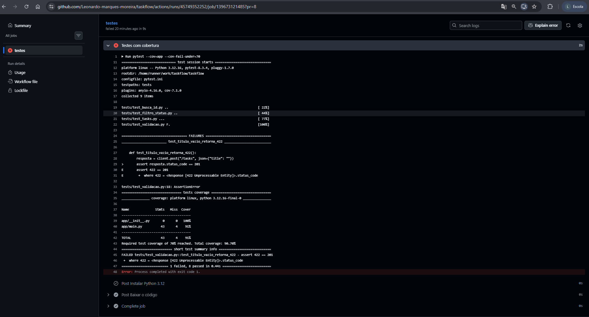
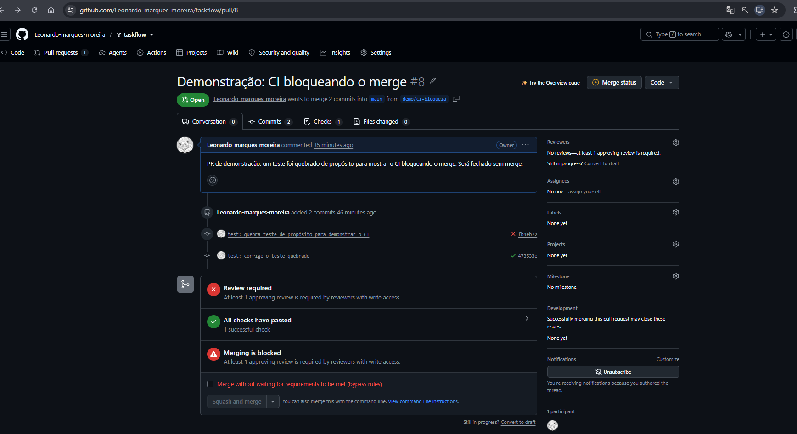

# TaskFlow


API REST de tarefas em Python (FastAPI). Projeto-base da disciplina **DevOps Tools** (ADS · UNIPAR · 2026).

> Este repositório começa **sem nenhuma automação**. A cada semana, sua dupla adiciona uma camada DevOps:
> versionamento → colaboração → CI → containers e deploy → infraestrutura como código → monitoramento.

## Endpoints

| Método | Rota | O que faz |
| --- | --- | --- |
| GET | `/tasks` | Lista todas as tarefas |
| POST | `/tasks` | Cria uma tarefa (`{"title": "...", "done": false}`) |
| PUT | `/tasks/{id}` | Atualiza uma tarefa |
| DELETE | `/tasks/{id}` | Remove uma tarefa |
| GET | `/tasks?done=true` | Filtra tarefas por status (`true` ou `false`) |
| GET | `/tasks/{id}` | Busca uma tarefa pelo id (404 se não existir) |


Os dados ficam em memória: reiniciou a API, as tarefas somem.

## Como rodar

Requisito: Python 3.12 ou mais recente.

```bash
python -m venv .venv
.venv\Scripts\activate.bat
pip install -r requirements.txt
uvicorn app.main:app --reload
```

Abra <http://127.0.0.1:8000/docs> para testar os endpoints pelo navegador.

## Como testar

```bash
pytest
```

## Estrutura

```
app/main.py          # a API
tests/test_tasks.py  # 3 testes automatizados
requirements.txt     # dependências com versões fixas
```

---

## Checkpoint 1 (tag `v0.1`): o que sua dupla deve fazer

- [x] Fazer **fork** deste repositório e adicionar o colega como *collaborator*
- [x] Criar um `.gitignore` para Python (inclua `.venv/` e `__pycache__/`)
- [x] Fazer **pelo menos 5 commits** no padrão [Conventional Commits](https://www.conventionalcommits.org/pt-br/v1.0.0/), dos dois integrantes
- [x] Substituir a seção "Integrantes" abaixo e completar este README
- [x] Adicionar o print do `git log --graph --oneline` do laboratório
- [x] Criar `docs/pbl-semana1.md` com a situação-problema EntregaJá
- [x] Criar a tag: `git tag v0.1` e `git push --tags`

## Integrantes

- Leonardo Marques Moreira RA:60000077 (@Leonardo-marques-moreira)
- Nome 2 (@usuario-github)

## Histórico de commits



## Pull Requests

- [#1: Template de PR](https://github.com/Leonardo-marques-moreira/taskflow/pull/1)
- [#2: Busca por id](https://github.com/Leonardo-marques-moreira/taskflow/pull/2)
- [#3: Filtro por status](https://github.com/Leonardo-marques-moreira/taskflow/pull/3)

## Integração contínua

Todo push e pull request para a `main` roda o workflow `ci.yml`, com lint (ruff) e testes com cobertura mínima de 70%. A `main` só aceita merge com o check `testes` verde.

**PR bloqueado pelo CI (check vermelho):**



**Log do erro:**



**Depois da correção (check verde):**



### GitHub Actions × Jenkins

| Critério | GitHub Actions | Jenkins |
| --- | --- | --- |
| Tempo de configuração | Minutos: um arquivo YAML no próprio repositório | Mais demorado: instalar o servidor e os plugins |
| Onde roda | Nos servidores do GitHub, sem infraestrutura própria | Num servidor mantido pela própria equipe |
| Quem mantém | O GitHub | A equipe, com atualizações e segurança |
| Legibilidade | YAML curto e direto | Jenkinsfile (Groovy) ou configuração pela interface |
