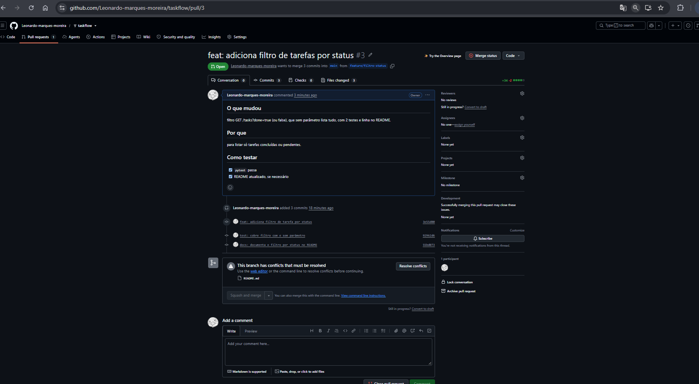

# Conflito de merge: Checkpoint 2

## O que entrou em conflito
Arquivo `README.md`, na tabela de endpoints, logo depois da linha do DELETE:

```
<<<<<<< HEAD
| GET | `/tasks?done=true` | Filtra tarefas por status (`true` ou `false`) |
=======
| GET | `/tasks/{id}` | Busca uma tarefa pelo id (404 se não existir) |
>>>>>>> origin/main
```

## Por que aconteceu
As duas branches saíram da mesma main e adicionaram uma linha no mesmo ponto do README: `feature/busca-id` adicionou a linha do `GET /tasks/{id}`, e `feature/filtro-status` adicionou a do filtro. O PR #2 foi mesclado primeiro. Quando o PR #3 foi aberto, a main já tinha mudado naquele trecho, e o Git não soube qual linha manter.

## Como resolvemos
Na branch `feature/filtro-status`:

```
git fetch origin
git merge origin/main
```

Abri o `README.md`, mantive as duas linhas na tabela e removi os marcadores. Rodei `pytest` (7 testes passaram), fiz `git add README.md`, o commit de merge e o `git push`. O PR #3 deixou de ter conflito e foi mesclado.

## Evidência
